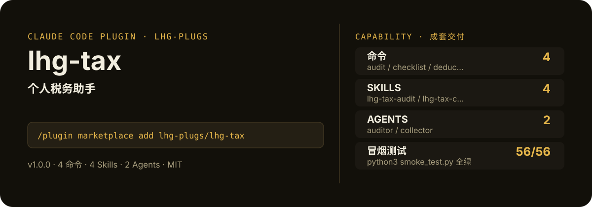

<!-- About 简介（推送后填写到仓库 About 栏）：
个人税务助手：收入构成梳理、专项附加扣除清单、易漏项提醒、申报材料 checklist、时间节点提醒。仅做信息整理，不给筹划建议，不编造政策数字。 ｜ 一键安装：/plugin marketplace add lhg-plugs/lhg-tax
-->
<!-- topics（推送后打）：claude-code, claude-plugin, agent-skills, tax, finance, deductions, checklist, chinese -->

<p align="center">
  
</p>

> **一句话介绍**：个人税务助手：收入构成梳理、专项附加扣除清单、易漏项提醒、申报材料 checklist、时间节点提醒。仅做信息整理，不给筹划建议，不编造政策数字。

**一键安装**：在 Claude Code 里运行

```bash
/plugin marketplace add lhg-plugs/lhg-tax
/plugin install lhg-tax@lhg-plugs
```

## 它能帮你做出什么

- **冒烟全绿**：`python3 smoke_test.py` 56 项全部通过（JSON 合法、frontmatter 完整、命令/skill/agent 齐全）。

## 它是什么

`lhg-tax` 是一个 Claude Code 插件（plugin 为主、skill 为辅）：

- **4 个命令**（小白入口）：`audit` 整理成果自查、`checklist` 申报材料 checklist、`deductions` 专项附加扣除单项梳理、`tax` 个人税务整理主流程
- **4 个平台中立 skill**（方法论，可移植到豆包/Workbuddy 等 agent 平台）：lhg-tax-audit, lhg-tax-checklist, lhg-tax-deductions, lhg-tax-income
- **2 个专家 agent**：auditor, collector
- **2 个 hooks**（`hooks/`：post_write_disclaimer.py, pre_prompt_compliance.py），关键操作前自动把关

## 为什么是它

不是一个 prompt，而是一套互相兜底的机制：

1. **硬门，不是提醒**：hooks 在关键操作前自动拦截或警告（见 `hooks/`），而不是只在文档里写一句"请注意"。
2. **方法论沉淀在 skill 里**：流程、检查清单、口径都写在 `skills/` 的方法论里，命令只是入口；换个 agent 平台也能复用同一套做法。
3. **可验，不是可信**：`fixtures/` 备有坏/好对照用例，`smoke_test.py` 一键验证，规则有没有生效、自己跑一遍就知道。

## 快速上手

```bash
# 1. 安装（Claude Code 里运行）
/plugin marketplace add lhg-plugs/lhg-tax
/plugin install lhg-tax@lhg-plugs

# 2. 个人税务整理主流程：收入构成梳理 → 专项附加扣除清单 → 易漏项提醒 → 申报
/lhg-tax:tax 二孩、有房贷、父母均超60岁
```

| 命令 | 作用 | 示例 |
|---|---|---|
| `/lhg-tax:audit` | 整理成果自查：跑确定性审计脚本 + 人工评审四项，输出分级报告，blocker 清零才算通过。 | `/lhg-tax:audit` |
| `/lhg-tax:checklist` | 申报材料 checklist：按收入项与扣除项生成材料清单，标注时间节点与官方办理渠道，附提交前五问核对。 | `/lhg-tax:checklist` |
| `/lhg-tax:deductions` | 专项附加扣除单项梳理：七项框架逐项过，输出适用/不适用/待确认清单与易漏项提醒。只列框架不编政策数字。 | `/lhg-tax:deductions 今年多了个孩子` |
| `/lhg-tax:tax` | 个人税务整理主流程：收入构成梳理 → 专项附加扣除清单 → 易漏项提醒 → 申报材料 checklist → 时间节点提… | `/lhg-tax:tax 二孩、有房贷、父母均超60岁` |

## 什么时候用 / 什么时候不用（FAQ）

**什么时候用：**

- 你需要整理成果自查时 → 用 `/lhg-tax:audit`
- 你需要申报材料 checklist时 → 用 `/lhg-tax:checklist`
- 你需要专项附加扣除单项梳理时 → 用 `/lhg-tax:deductions`

**什么时候不用：**

- 你只需要其中一个零散能力时 → 本插件是成套流程，单点需求用更轻量的 skill 更合适
- 你希望 AI 完全自由发挥、不接受任何自查与硬门时 → 它的规则审计与 hooks 会介入（可关，但那就别装它）
- 个人税务助手，扣除项清单与申报checklist整理（仅供参考） ｜ 一键安装：/plugin marketplace add lhgplugs/lhgtax
- 你的场景不在上面命令表覆盖范围内时 → 先看命令表，没有对应命令就别硬套

## 目录结构

```
lhg-tax/
├── smoke_test.py          # 一键冒烟测试
├── ATTRIBUTION.md         # 灵感来源与许可声明
├── LICENSE                # MIT
├── README.md              # 本文件
├── .claude-plugin/
├── agents/
├── commands/
├── fixtures/
├── hooks/
├── scripts/
├── skills/
```

## 自检与反馈

本插件自带质检：每次使用后可跑 `python3 smoke_test.py` 一键验证（本次实测 56 项全部通过）。

发现 bug 或有改进建议，以 `[QC] <一句话问题>` 为标题提交到 https://github.com/lhg-plugs/lhg-tax/issues，正文写清"复现步骤 → 实际表现 → 期望表现"。

同门插件见 [lhg-plugs](https://github.com/lhg-plugs)，86 个插件的完整矩阵在 [marketplace](https://github.com/lhg-plugs/marketplace) 维护。

## 出品：刘洪光

本插件由真人出镜 IP「刘洪光」（安徽合肥）出品，归属 [lhg-skills](https://github.com/lhg-skills)。

- GitHub 主页：https://github.com/lhg-skills —— 全部 skill 开源在此，欢迎 star
- 抖音：搜「刘老师讲AI实战」
- 微信：lhgsmsw
